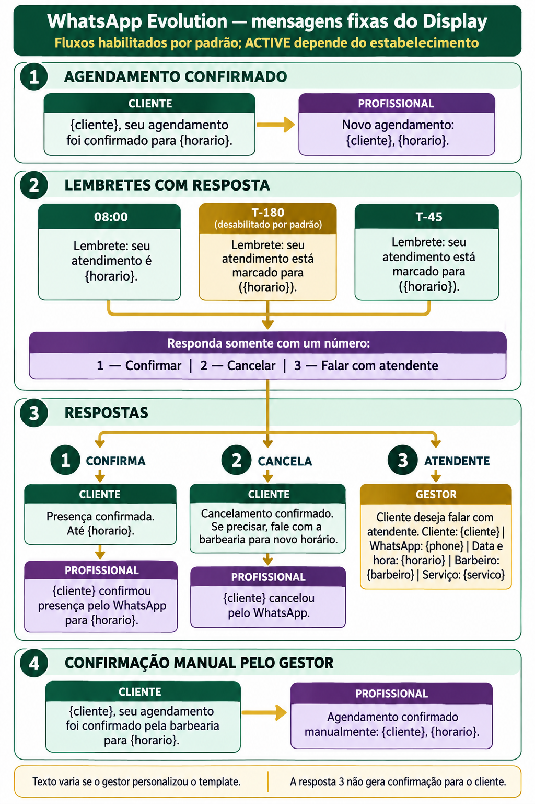

# WhatsApp Evolution — fluxo e mensagens fixas do Display



Este documento descreve o fluxo QR (`QR_WEB`) encontrado no código e nas migrations do repositório em 15/10/2026. O texto enviado pode divergir dos exemplos abaixo quando o gestor personalizou o template da organização.

## 1. Ciclo de envio

1. Um agendamento passa a `CONFIRMED` ou o runtime agenda uma automação habilitada.
2. O PostgreSQL verifica organização, conexão QR ativa, modo/runtime `ACTIVE`, pausa, dados e consentimentos aplicáveis. Jobs levam chave de deduplicação para evitar duplicidade.
3. Worker dedicado/dispatcher reclama o job da fila persistente com lease e valida novamente conexão, automação, consentimento e janela de envio.
4. O dispatcher renderiza o template e chama `POST /message/sendText/{instance}` na Evolution, com `number` e `text`.
5. A resposta do endpoint registra submissão/ID do provedor. `MESSAGES_UPDATE` atualiza recibos como enviado, entregue, lido ou falha. Submetido não significa recebido no aparelho.

`CONNECTION_UPDATE` atualiza conexão. `MESSAGES_UPSERT` registra mensagens recebidas antes de interpretá-las. A fila, as tentativas e os eventos persistem no Supabase; a Evolution é transporte.

## 2. Gatilhos e mensagens

Os exemplos são os textos fallback da implementação. Templates salvos por organização têm precedência. O painel permite ativar/desativar os fluxos transacionais; T-180 começa desativado por padrão. As automações personalizadas também exigem configuração e ativação.

| Gatilho / destinatário | Texto fallback atual | Observações |
| --- | --- | --- |
| Agendamento confirmado → cliente | `{cliente}, seu agendamento foi confirmado para {horario}.` | Uma vez por transição/versão; exige telefone e consentimento transacional. |
| Agendamento confirmado → profissional | `Novo agendamento: {cliente}, {horario}.` | Uma vez por transição/versão; exige aviso ao profissional habilitado e telefone dele. |
| Dia do atendimento, 08:00 no fuso da organização → cliente | `Lembrete: seu atendimento é {horario}.` + opções 1/2/3 | Solicitação interativa expira no início do atendimento. Se 08:00 já passou ou não antecede o horário, o job é ignorado. |
| 180 min antes → cliente | `Lembrete: seu atendimento está marcado para ({horario}).` + opções 1/2/3 | Toggle inicia desligado. O renderer atual troca “começa em 3 horas” por “está marcado para”; portanto, o fallback enviado não informa mais “3 horas”. |
| Offset T-45 configurado antes → cliente | `Lembrete: seu atendimento está marcado para ({horario}).` + opções 1/2/3 | Toggle inicia ligado; offset configurável, normalmente 45 min. O renderer atual troca “começa em 45 minutos” por “está marcado para”. |
| Cliente responde `1` → cliente | `Presença confirmada. Até {horario}.` | Marca confirmação de presença e grava evento na agenda. |
| Cliente responde `1` → profissional | `{cliente} confirmou presença pelo WhatsApp para {horario}.` | Aviso depende do telefone do profissional. |
| Cliente responde `2` → cliente | `Cancelamento confirmado. Se precisar, fale com a barbearia para novo horário.` | Cancela transacionalmente a reserva, registra origem WhatsApp e libera o horário. |
| Cliente responde `2` → profissional | `{cliente} cancelou pelo WhatsApp.` | Aviso depende do telefone do profissional. |
| Cliente responde `3` → gestor | `Cliente deseja falar com atendente.\n\nCliente: {cliente}\nWhatsApp: {phone}\nData e hora: {horario}\nBarbeiro: {barbeiro}\nServiço: {servico}` | Registra solicitação de contato. Requer número de notificação do gestor. **Não há mensagem de confirmação ao cliente neste ramo atualmente.** |
| Resposta inválida (até 2 tentativas) → cliente | `Não entendi sua resposta.\n\nResponda somente com um número:\n1 — Confirmar\n2 — Cancelar\n3 — Falar com atendente` | O sistema aceita somente `1`, `2` ou `3` isolados. Na terceira inválida, encaminha como solicitação ao gestor. |
| Mais de uma reserva pendente sem resposta citada → cliente | `Qual reserva? Responda RESERVA e o número abaixo.` + lista `n — DD/MM HH:mm` | Lista até 20 horários, válida por 5 minutos; resposta usa `RESERVA n`. |
| Gestor confirma manualmente pela agenda → cliente | `{cliente}, seu agendamento foi confirmado pela barbearia para {horario}.` | Cancela lembretes ainda pendentes daquela reserva. |
| Gestor confirma manualmente pela agenda → profissional | `Agendamento confirmado manualmente: {cliente}, {horario}.` | Enviada como job separado. |

Todas as mensagens de lembrete incluem:

```text
Responda somente com um número:
1 — Confirmar
2 — Cancelar
3 — Falar com atendente
```

Há ainda seis mensagens personalizadas, com corpo escrito pelo gestor; não existe texto fixo comum para elas:

- **Pós-serviço:** 14, 28 e 40 dias após a conclusão mais recente. Uma nova reserva ou retorno concluído suprime a recuperação.
- **Aniversário:** enviada ao cliente na data, se estiver habilitada e houver data de nascimento.
- **Datas especiais** e **promoções/campanhas:** o gestor agenda a campanha e escolhe público/horário.

Essas mensagens dependem do runtime ativo, consentimento de marketing separado, telefone válido e limites de frequência/janela. O agendador roda em lotes; campanhas respeitam a janela local configurada no banco (09:00–18:00). O corpo personalizado é livre até 4.096 caracteres.

## 3. Respostas e validações

- `MESSAGES_UPSERT` é guardado antes do processamento. Mensagens enviadas pela própria conta não são tratadas como respostas.
- Para uma solicitação pendente, o telefone do remetente precisa corresponder ao cliente, a conexão precisa estar ativa e o atendimento ainda válido/confirmado, na versão correta, com consentimento transacional vigente.
- `1` confirma presença; `2` cancela; `3` marca pedido de atendente.
- Sem solicitação vigente, o código não aplica a mudança. Se houver várias solicitações, pede escolha `RESERVA n`.
- Texto diferente de `1`, `2` ou `3` recebe o prompt de repetição. Após duas tentativas, o terceiro erro segue para o gestor como solicitação de atendente.
- Se o número do gestor não estiver configurado, o ramo `3` falha com `MANAGER_NOTIFICATION_PHONE_UNAVAILABLE`; não se deve presumir que o pedido chegou ao gestor.

## 4. Variáveis de template do Display

Estas são substituições implementadas pelo Display, não tokens da Evolution:

| Token | Valor renderizado | Fallback quando ausente |
| --- | --- | --- |
| `{cliente}` | Nome do cliente (`customer_name`) | `cliente` |
| `{barbeiro}` | Nome do profissional (`barber_name`) | `profissional` |
| `{horario}` | Data e hora em `pt-BR`, no fuso da organização | `seu horário agendado` |
| `{servico}` | Nome(s) do serviço (`service_names`) | `Serviço não informado` |

O renderer também transforma as sequências literais `\\n` em quebras de linha reais. O token `{phone}` do aviso ao gestor é interpolado pelo código como dado do remetente, não é um token de template atualmente substituível pelo gestor. Tokens desconhecidos, como `{unidade}` ou `{valor}`, não têm substituição implementada e podem sair literalmente.

Em mensagens personalizadas de aniversário, pós-serviço e campanha, o job normalmente fornece o nome do cliente, mas não horário, barbeiro ou serviço. Portanto, os outros tokens existem no renderer, mas podem virar os fallbacks nesses tipos de mensagem.

## 5. Fila de compatibilidade antiga

O repositório ainda contém `notification_outbox` e a Edge Function `whatsapp-send-outbox`, separados da fila V2. Essa função retém renderizadores antigos para confirmação, cancelamento e lembrete em texto. Para a Evolution, o renderizador legado pode acrescentar `Digite 1 para confirmar, 2 para cancelar ou 3 para reagendar.`; já o prompt legado de cancelamento diz `Confirma o cancelamento de [horário]?` e aceita `1` para cancelar ou `2` para manter. A presença desses caminhos no código não prova que determinada organização os esteja usando: a configuração e os jobs persistidos da organização precisam ser verificados. Não misture esses prompts com o fluxo V2, no qual `3` significa falar com atendente.

## 6. O que a Evolution documenta

O caminho usado pelo QR Display é envio de texto comum (`sendText`). Na documentação da Evolution, os recursos aplicados ao texto são emojis, negrito com `*texto*`, itálico com `_texto_`, tachado com `~texto~`, monoespaçado com crases triplas e quebra de linha com `\\n`. **A documentação de envio de texto não define placeholders como `{cliente}` ou `{horario}`.** A Evolution recebe a string já renderizada pelo Display.

O endpoint documenta endereço/instância, número destinatário, opções de atraso/presença e o texto. O retorno pode iniciar em `PENDING` e os eventos `MESSAGES_UPDATE` trazem mudanças de estado. A documentação oficial disponível para esse endpoint está no repositório de docs arquivado em junho/2024; a própria referência v2 hoje tem lacunas técnicas. Assim, ela não oferece uma lista oficial atual de variáveis de texto. O endpoint separado `sendTemplate`/templates é outro recurso e não é o transporte usado neste fluxo QR.

Fontes oficiais consultadas:

- [Evolution API — Send Plain Text](https://github.com/evolution-foundation/evolution-docs/blob/main/docs/05-Endpoints/00-send-plain-text.md)
- [Evolution API — Webhooks e eventos](https://github.com/evolution-foundation/evolution-docs/blob/main/docs/02-Configuration/Webhooks.md)
- [Evolution API — rota de envio de texto/template no código-fonte](https://github.com/evolution-foundation/evolution-api/blob/main/src/api/routes/sendMessage.router.ts)

## 7. Limite do diagnóstico

Este levantamento verificou o código local e as migrations, não consultou textos privados configurados por organização nem fez envio real. Para afirmar o texto exato de uma organização específica, é necessário ler seu template persistido. `SUBMITTED`/`PENDING`, uma chamada HTTP bem-sucedida ou a criação de job não provam entrega ou leitura no aparelho.

## Referências no repositório

- `supabase/functions/_shared/whatsapp-templates.ts` — renderização e textos fallback V2.
- `supabase/functions/whatsapp-v2-dispatcher/index.ts` — envio, webhook inbound e leitura de respostas.
- `supabase/functions/_shared/whatsapp.ts` — chamada à Evolution API.
- `supabase/functions/whatsapp-qr-webhook/index.ts` — recebimento de conexão, mensagens e recibos.
- `supabase/migrations/20260906230249_whatsapp_reliable_runtime.sql` — gatilhos, agendador, validação de resposta e fila.
- `supabase/migrations/20260821115548_whatsapp_agenda_response_statuses.sql` e `supabase/migrations/20261014180506_fix_whatsapp_qr_activation_and_legacy_manual_confirmation.sql` — respostas de agenda e confirmação manual.
